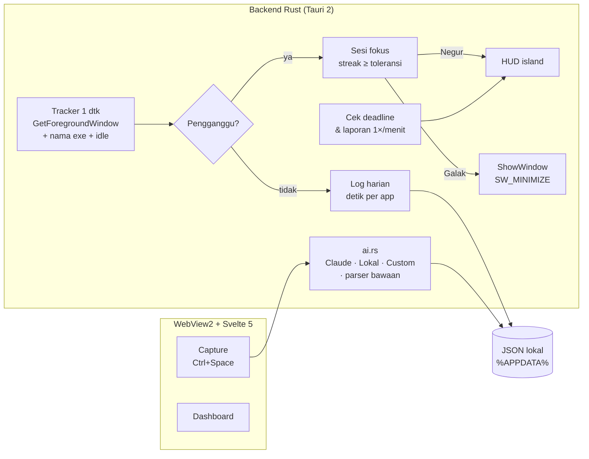

<p align="center">
  
</p>

<p align="center">
  <a href="https://github.com/BillyNabil/gaspol/releases/latest"></a>
  
  
  
  
  <a href="LICENSE"></a>
</p>

<p align="center">
  <b>Ctrl+Space → satu kalimat → langsung jadi tugas + langkah pertama.</b><br>
  Lalu Gaspol jaga kamu tetap di jalur: negur kalau kabur ke YouTube, nagih kalau deadline mepet,<br>
  dan kasih laporan jujur tiap malam. Tanpa input manual, tanpa harus ingat buka app.
</p>

<p align="center"><sub>English: a tiny tray app for Windows that turns one-line notes into actionable tasks, watches the active window during focus sessions, nudges you back when you drift to distractions, and reports where your day actually went.</sub></p>

<br>

<p align="center">
  
</p>

---

## Kenapa Gaspol?

Kebanyakan app produktivitas mati karena dua hal: **harus diisi manual** dan **lupa dibuka**. Gaspol dibalik:

| Masalah klasik | Cara Gaspol |
| --- | --- |
| Ribet input tugas | Satu kalimat santai (`render teaser klien A sebelum jumat`) → AI pecah jadi tugas, deadline, project, dan langkah pertama. |
| Lupa buka app | Nyala sendiri saat Windows start, tinggal di tray. Kamu nggak perlu ingat apa-apa. |
| Susah mulai | Selalu ada **satu** tugas paling mendesak dengan langkah pertama yang bisa dimulai < 2 menit. |
| Gampang ke-distract | Pantau jendela aktif. Kabur ke YouTube/Discord/TikTok → island di atas layar langsung negur. |
| Nunda sampai mepet | Deadline ≤ besok tapi belum disentuh → ditagih, lengkap dengan langkah pertamanya. Tiap "Nanti" dihitung. |
| Nggak tahu waktu habis ke mana | Pencatat waktu otomatis per app + laporan harian jam 22:00. |

## Fitur

### ⚡ Tangkap cepat — `Ctrl+Space` dari mana saja


Spotlight-style. Ketik, `Enter`, beres. `Ctrl+Enter` untuk langsung mulai sesi fokus. Parser bawaan paham bahasa sehari-hari (`besok`, `lusa`, `sebelum jumat`, `20/11`, `klien X`), dan kalau AI aktif langkah-langkahnya jadi spesifik.

### 🏝️ HUD "island" yang berubah bentuk


Pil timer kecil di atas layar selama sesi fokus (click-through, nggak menghalangi). Begitu kamu kabur ke pengganggu, pil itu membesar jadi teguran dengan animasi spring. Bentuk yang sama dipakai untuk penagih deadline, ringkasan sesi, dan laporan harian.

### 🎯 Sesi fokus dengan 3 tingkat kegalakan


| Mode | Perilaku |
| --- | --- |
| **Pasif** | Cuma mencatat diam-diam. |
| **Negur** | Island muncul setelah 4 detik di pengganggu; ditegur ulang tiap 90 detik kalau masih betah. Tombol **Balik kerja** langsung fokus ke jendela kerja terakhir. |
| **Galak** | Jendela pengganggu langsung di-minimize. |

### 📊 Laporan harian yang jujur


Total fokus vs ngelantur, waktu per app (pengganggu ditandai oranye), riwayat sesi, dan tugas yang paling sering kamu tunda. Muncul otomatis jam 22:00, bisa geser ke hari-hari sebelumnya.

### 🧠 Otak AI pilihan kamu


| Provider | Catatan |
| --- | --- |
| **Tanpa AI** | Parser bawaan (tanggal, hari, klien). Tetap jalan offline. |
| **Claude API** | Default `claude-haiku-5-5` — cepat dan murah, nggak makan VRAM. |
| **Lokal** | Server OpenAI-compatible: LM Studio (`:1234/v1`) atau Ollama (`:11434/v1`). Tombol **Cari model** baca daftar model dari server. |
| **Custom** | Provider apa pun, format **OpenAI-compatible** (OpenRouter, DeepSeek, Groq, z.ai, LiteLLM, vLLM…) atau **Anthropic-compatible**. |

API key disimpan di **Windows Credential Manager**, bukan file teks. Output `<think>` dari model reasoning otomatis dibuang.

## Ringan

Diukur di Ryzen 7 5700X, Windows 11, mode tray:

| | |
| --- | --- |
| Installer | **2,4 MB** (NSIS, install per-user, tanpa admin) |
| Proses inti (Rust) | **~8 MB** RAM |
| WebView2 | **~166 MB** private (dashboard dihancurkan saat ditutup; HUD + capture berbagi satu renderer) |
| CPU saat idle | **~0%** (polling jendela aktif 1×/detik) |

## Install

1. Download `Gaspol_x.y.z_x64-setup.exe` dari [**Releases**](https://github.com/BillyNabil/gaspol/releases/latest).
2. Jalankan. Gaspol ter-install di `%LOCALAPPDATA%\Gaspol` dan otomatis nyala tiap Windows start.
3. Tekan `Ctrl+Space`, ketik tugas pertamamu.

> Butuh WebView2 Runtime — sudah bawaan Windows 11 dan sebagian besar Windows 10.

## Cara kerja



- **Deteksi pengganggu**: pola `exe:discord` dicocokkan ke nama proses, pola biasa (`youtube`) dicocokkan ke judul tab browser — jadi buka docs `discord.js` di VS Code nggak dihitung. Daftar bisa diedit di Pengaturan.
- **Idle**: > 3 menit tanpa input dianggap tidak di depan laptop, kecuali sedang di pengganggu (nonton YouTube tanpa menyentuh mouse tetap dihitung).

## Privasi

- Semua data (`tasks.json`, `settings.json`, `days/*.json`) tersimpan lokal di `%APPDATA%\dev.gaspol.desktop`.
- Judul jendela hanya dibaca dan diklasifikasi di laptopmu; yang disimpan cuma **nama app + durasi**, bukan judulnya.
- Yang dikirim keluar hanya kalimat tugas yang kamu ketik, dan hanya ke provider AI yang kamu pilih.

## Develop

**Prasyarat:** [Rust](https://rustup.rs) (MSVC), Node.js 20+, dan Visual Studio Build Tools dengan workload *Desktop development with C++*.

```bash
npm install
npx tauri dev        # jalankan app dengan hot reload
npx tauri build      # installer NSIS di src-tauri/target/release/bundle/nsis
```

> **Path terlalu panjang?** Kalau `link.exe` gagal dengan `LNK1104`, pindahkan output build ke path pendek lewat `src-tauri/.cargo/config.toml`:
> ```toml
> [build]
> target-dir = "C:/gaspol-target"
> ```

### Mode demo (tanpa Tauri)

UI bisa dibuka di browser biasa dengan data contoh — dipakai untuk screenshot di README ini:

```bash
npm run dev
```

| URL | Isi |
| --- | --- |
| `localhost:1420/?demo=idle` | Dashboard |
| `localhost:1420/?demo=live` | Sesi fokus berjalan |
| `localhost:1420/?demo=idle&r#report` | Laporan |
| `localhost:1420/?win=capture&demo=done` | Capture bar + hasil |
| `localhost:1420/?win=hud&demo=nudge` | HUD (`pill`, `nudge`, `remind`, `done`, `report`) |

### Struktur

```
src-tauri/src/
├── main.rs      # window, tray, hotkey, autostart, commands
├── tracker.rs   # loop 1 dtk: klasifikasi app, sesi fokus, pengingat, laporan
├── ai.rs        # Claude / OpenAI-compatible / Anthropic-compatible + parser bawaan
├── store.rs     # model data + JSON atomic write
└── win.rs       # Win32: jendela aktif, nama exe, idle, minimize
src/
├── views/       # Main · Today · Report · Settings · Capture · Hud
└── lib/         # api, util, jembatan Tauri, data demo
```

## Roadmap

- [ ] **Mode Kerja** — satu klik buka After Effects + folder project + playlist, tutup pengganggu, mulai fokus.
- [ ] **Antrian render** Blender (`blender -b`) & After Effects (`aerender`) di background, notifikasi saat selesai, rapikan file hasil.
- [ ] Statistik mingguan & streak.
- [ ] Posisi HUD per monitor.

## Lisensi

[MIT](LICENSE) © 2026 Billy Nabil
