<p align="center">
  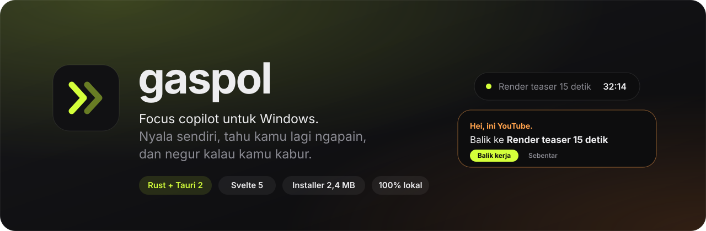
</p>

<p align="center">
  <a href="https://github.com/BillyNabil/gaspol/releases/latest"></a>
  
  
  
  
  <a href="LICENSE"></a>
</p>

<p align="center">
  <b>Ctrl+Space → satu kalimat → langsung jadi tugas + langkah pertama.</b><br>
  Lalu Gaspol jaga kamu tetap di jalur: negur kalau kabur ke YouTube, render Blender/AE di background,<br>
  nagih kalau deadline mepet, dan kasih laporan jujur tiap malam. Tanpa input manual, tanpa harus ingat buka app.
</p>

<p align="center"><sub>English: a tiny tray app for Windows that turns one-line notes (or screenshots, or your voice) into actionable tasks, watches the active window during focus sessions, nudges you back when you drift, queues Blender / After Effects renders, and reports where your day — and your billable hours — actually went.</sub></p>

<br>

<p align="center">
  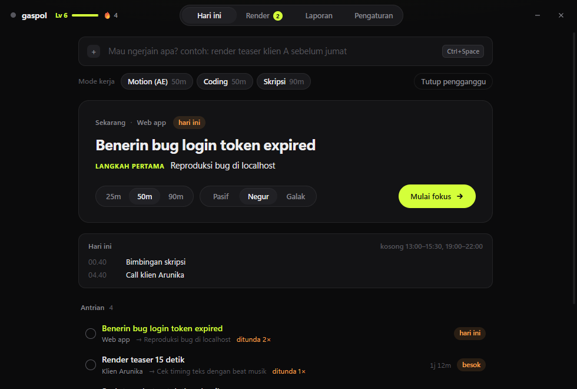
</p>

---

## Kenapa Gaspol?

Kebanyakan app produktivitas mati karena dua hal: **harus diisi manual** dan **lupa dibuka**. Gaspol dibalik:

| Masalah klasik | Cara Gaspol |
| --- | --- |
| Ribet input tugas | Satu kalimat, screenshot chat klien, teks yang diblok, atau suara → tugas + deadline + project + langkah. |
| Lupa buka app | Nyala sendiri saat Windows start, tinggal di tray. Rencana pagi muncul sendiri. |
| Susah mulai | Selalu ada **satu** tugas paling mendesak dengan langkah pertama < 2 menit. Mode Kerja buka semua app-nya sekali klik. |
| Gampang ke-distract | Pantau jendela aktif. Kabur ke YouTube → island nanya "berapa menit?", lewat batas → ditegur. Tutorial Blender nggak dihitung. |
| Kerjaan berulang | Antrian render Blender & After Effects di background, hasil export dirapikan otomatis. |
| Nunda sampai mepet | Estimasi dikoreksi pakai kebiasaanmu meleset → ditagih lebih awal kalau waktunya nggak cukup. |
| Nggak tahu waktu habis ke mana | Waktu per app, peta jam produktif mingguan, jam per klien → langsung jadi invoice. |

## Fitur

### ⚡ Tangkap apa pun — `Ctrl+Space` dari mana saja

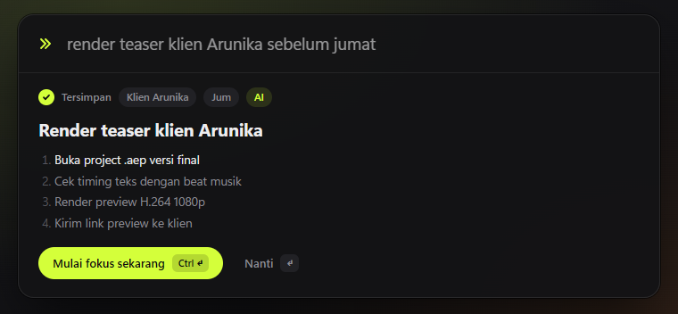

- **Kalimat santai** — parser bawaan paham `besok`, `lusa`, `sebelum jumat`, `20/11`, `klien X`.
- **Screenshot** — `Ctrl+V` gambar chat klien/dosen → AI ubah jadi satu tugas berisi checklist revisi.
- **Teks yang diblok** — blok teks di app mana pun, tekan `Ctrl+Shift+Space`.
- **Daftar per baris** — tempel list revisi → baris pertama jadi judul, sisanya langkah.
- **Suara** — klik mic, ngomong, Whisper (Groq / OpenAI / lokal) menulis tugasnya.
- **Template** — kalimat berisi `teaser`, `map roblox`, `bug`, `skripsi`, … pakai kerangka langkah milikmu.
- **Dari HP** — kirim pesan ke bot Telegram pribadimu → masuk ke daftar tugas.

### 🏝️ Island yang berubah bentuk

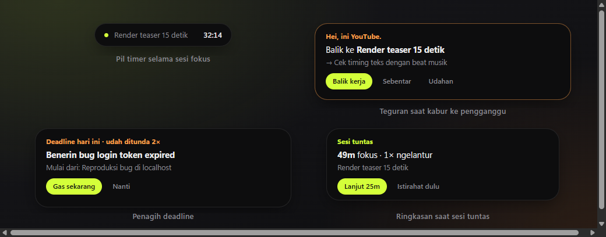
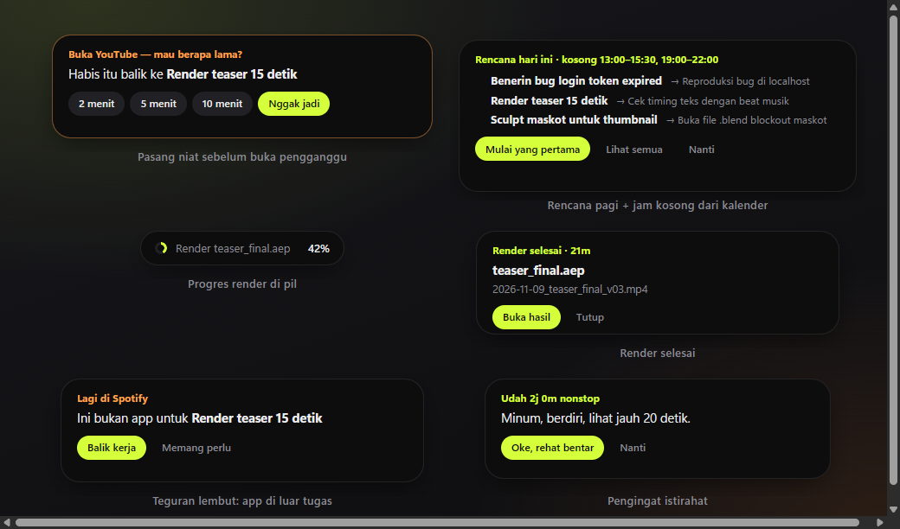

Pil timer kecil di atas layar (click-through, bisa pilih monitor). Bentuk yang sama membesar jadi teguran, **pasang niat** ("2 / 5 / 10 menit?"), penagih deadline, **rencana pagi** dengan jam kosong dari kalender, progres & selesai render, pengingat istirahat, dan laporan malam.

### 🎯 Fokus yang pintar

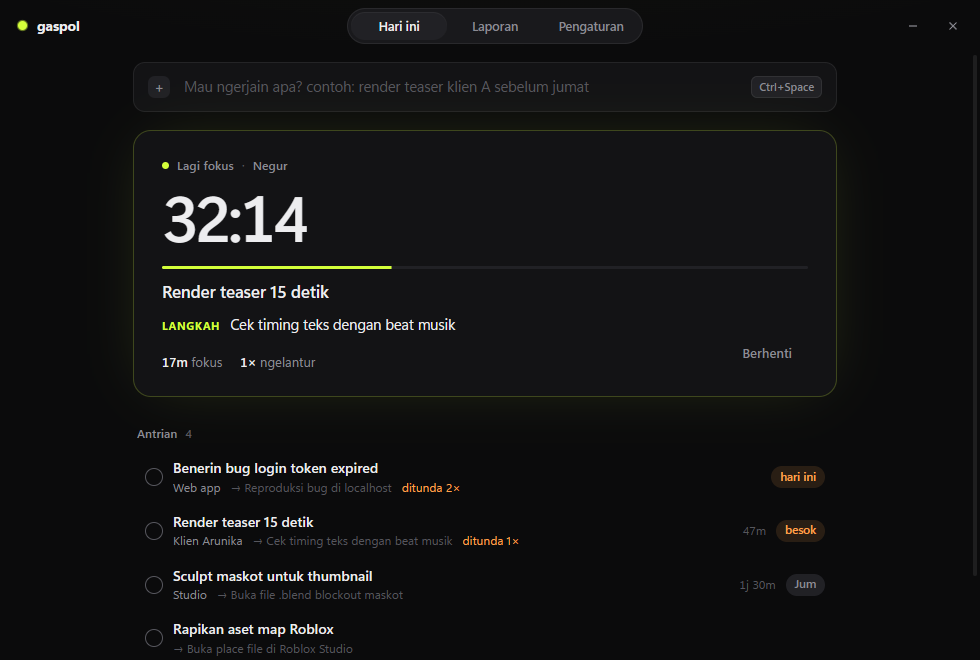

| | |
| --- | --- |
| **3 tingkat kegalakan** | Pasif (cuma catat) · Negur (island muncul) · Galak (jendela pengganggu di-minimize, opsional **blokir situs** lewat file hosts). |
| **Pasang niat** | Buka pengganggu → pilih mau berapa menit. Habis waktunya baru ditegur. |
| **Paham konteks** | Judul tab berisi `tutorial`, `docs`, `blender`, atau kata dari tugasmu tidak dihitung ngelantur. |
| **App sah per tugas** | Isi `exe:afterfx, figma` di tugas → kerja di app lain ditegur pelan. |
| **Lindungi flow** | Lagi asik saat waktu habis → +15 menit diam-diam, tanpa interupsi. |
| **Istirahat** | 2 jam aktif nonstop → diingatkan minum & peregangan. |
| **Mode Kerja** | Satu klik: buka app/folder/URL, tutup Discord & kawan-kawan, putar musik fokus, mulai sesi. |
| **Catat otomatis** | Tanpa sesi pun, jendela `Skripsi_bab3.docx` tercatat ke tugas "Revisi skripsi". |

### 🎬 Antrian render Blender & After Effects

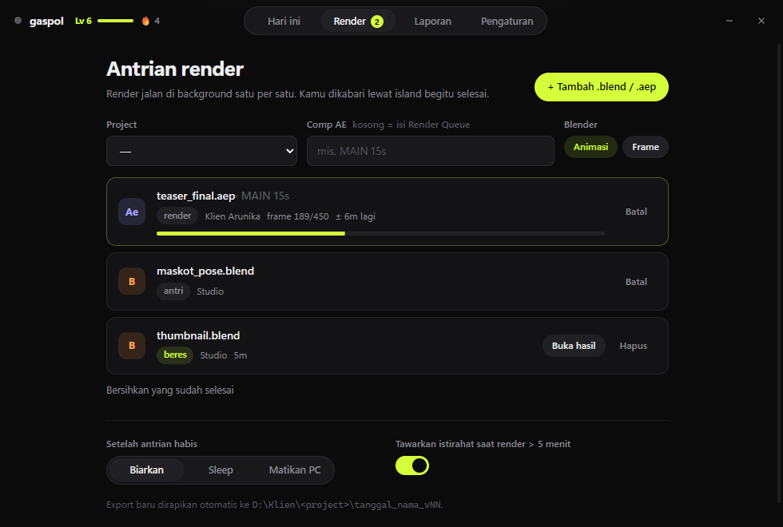

Seret `.blend` / `.aep` ke jendela → dirender satu per satu lewat `blender -b` dan `aerender` dengan progres per frame dan perkiraan sisa waktu. Island mengabari saat selesai (plus Telegram), dan PC bisa **sleep / mati** begitu antrian habis. Render di luar Gaspol (aerender, Blender Render, ffmpeg) juga terdeteksi → ditawari istirahat tanpa dihitung kabur.

**Rapikan export**: video/audio baru di folder yang dipantau dipindah ke `<root>\<project>\2026-11-09_nama_v03.mp4` — versi naik otomatis.

### 📊 Laporan harian, mingguan, dan klien

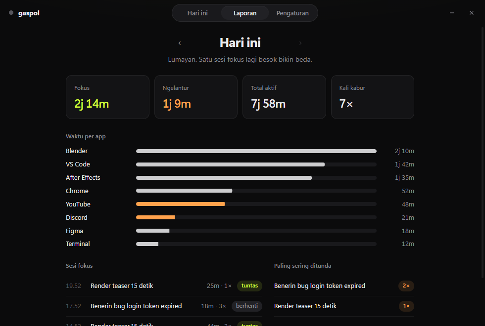
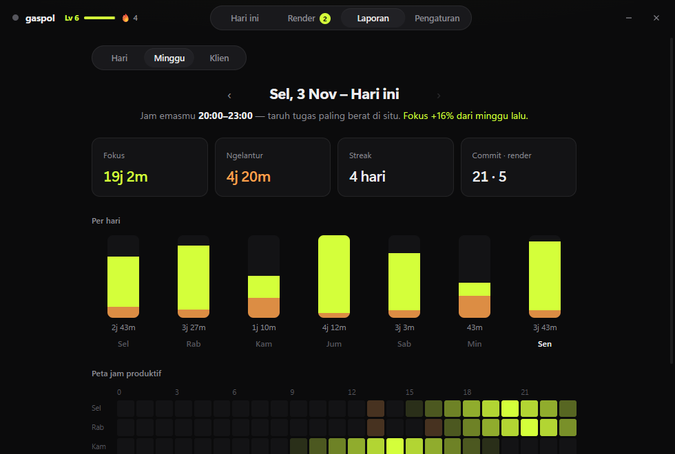
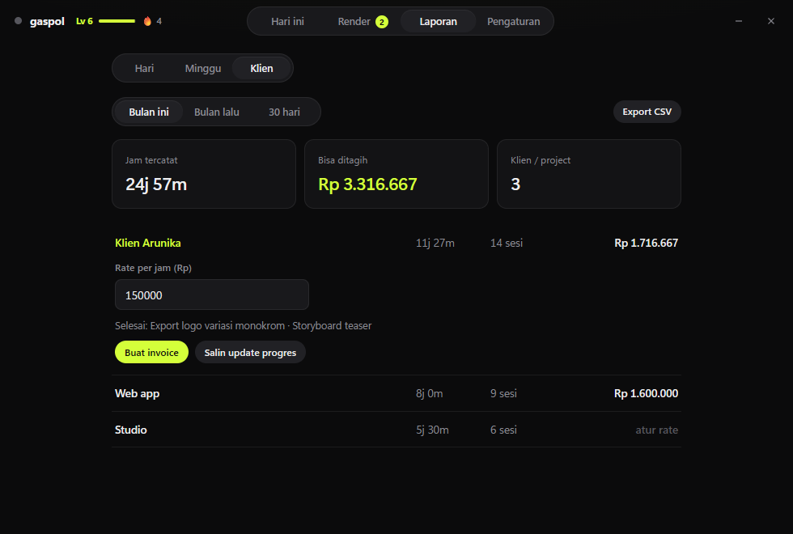

- **Hari**: fokus vs ngelantur, waktu per app, sesi, commit, tugas paling sering ditunda.
- **Minggu**: bar per hari, peta jam produktif 7×24, **jam emasmu**, perbandingan dengan minggu lalu.
- **Klien**: jam per project × rate → total bisa ditagih, **invoice HTML** siap Ctrl+P → PDF, export CSV, dan **update progres** yang ditulis AI untuk dikirim ke klien.
- **Estimasi yang belajar**: Gaspol mengukur kamu biasanya meleset berapa kali lipat dan mengoreksi sisa waktu tiap tugas.
- **Level & streak**: XP dari menit fokus nyata, streak hari dengan ≥ 25 menit fokus.
- **Akuntabilitas**: ringkasan malam dikirim ke webhook Discord/Slack temanmu (opsional).

### 🔌 Integrasi

| | |
| --- | --- |
| **Git** | Commit baru → tugas di project yang sama tersentuh, langkah yang mirip pesan commit dicentang. |
| **Kalender** | Baca feed iCal rahasia Google Calendar untuk jam kosong; ekspor `gaspol.ics` (deadline + sesi) untuk diimpor balik. |
| **Telegram** | Bot pribadi (di-pair dengan kode): kirim tugas, `/hari`, `/fokus`, `/stop`, `/laporan`; pengingat & render selesai dikirim ke HP. |
| **Update otomatis** | Versi baru dicek saat dashboard dibuka, dipasang dengan satu klik (installer ditandatangani). |

### 🧠 Otak AI pilihan kamu

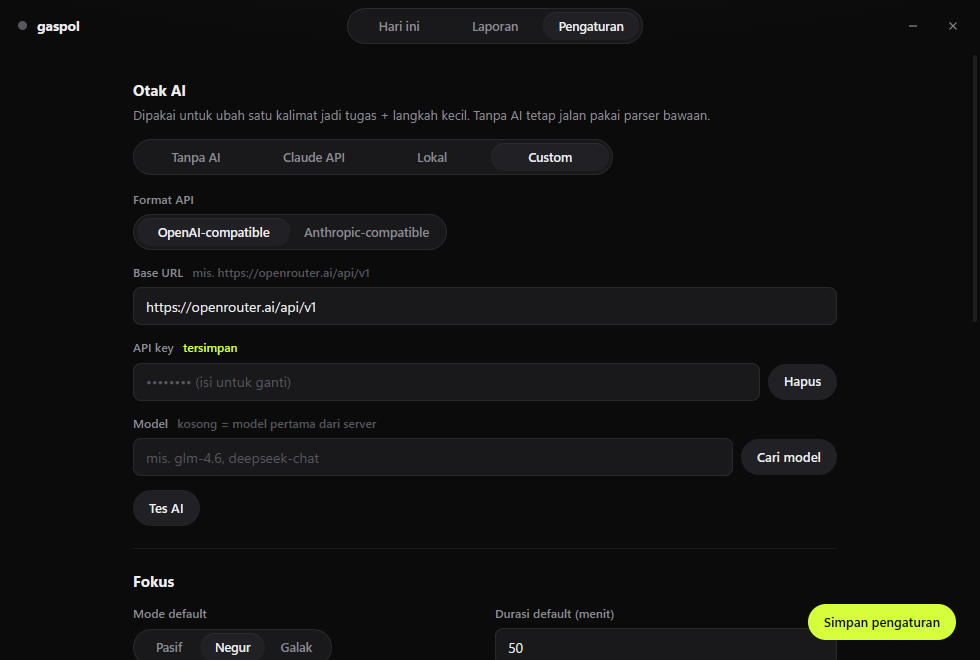

| Provider | Catatan |
| --- | --- |
| **Tanpa AI** | Parser bawaan + template. Tetap jalan offline. |
| **Claude API** | Default `claude-haiku-5-5` — cepat, murah, bisa baca screenshot. |
| **Lokal** | Server OpenAI-compatible: LM Studio (`:1234/v1`) atau Ollama (`:11434/v1`). |
| **Custom** | Provider apa pun, format **OpenAI-compatible** (OpenRouter, DeepSeek, Groq, z.ai, LiteLLM, vLLM…) atau **Anthropic-compatible**. |

API key & token disimpan di **Windows Credential Manager**, bukan file teks.

## Ringan

Diukur di Ryzen 7 5700X, Windows 11, mode tray:

| | |
| --- | --- |
| Installer | **~2,5 MB** (NSIS, install per-user, tanpa admin) |
| Proses inti (Rust) | **~8 MB** RAM |
| WebView2 | **~166 MB** private (dashboard dihancurkan saat ditutup; HUD + capture berbagi satu renderer) |
| CPU saat idle | **~0%** (polling jendela aktif 1×/detik) |

## Install

1. Download `Gaspol_x.y.z_x64-setup.exe` dari [**Releases**](https://github.com/BillyNabil/gaspol/releases/latest).
2. Jalankan. Kalau muncul SmartScreen: **More info → Run anyway**. Gaspol ter-install di `%LOCALAPPDATA%\Gaspol` dan otomatis nyala tiap Windows start.
3. Tekan `Ctrl+Space`, ketik tugas pertamamu. Versi berikutnya datang lewat update otomatis.

> Butuh WebView2 Runtime — sudah bawaan Windows 11 dan sebagian besar Windows 10.

## Cara kerja

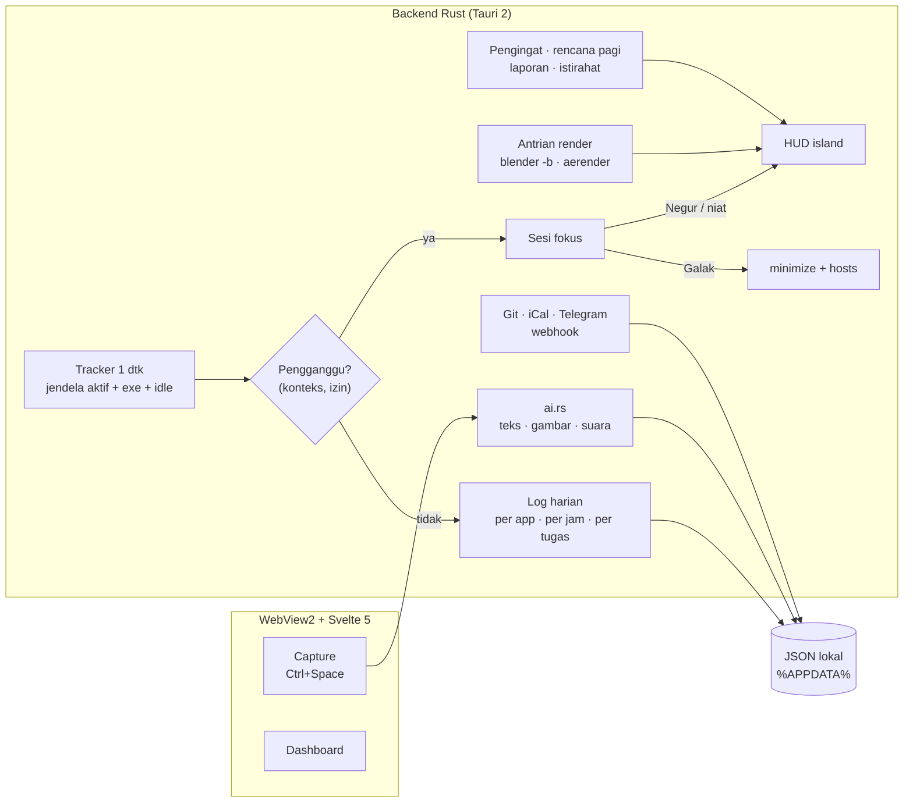

- **Deteksi pengganggu**: pola `exe:discord` dicocokkan ke nama proses, pola biasa (`youtube`) ke judul tab browser — jadi buka docs `discord.js` di VS Code nggak dihitung. Daftar bisa diedit di Pengaturan.
- **Idle**: > 3 menit tanpa input dianggap tidak di depan laptop, kecuali sedang di pengganggu.

## Privasi

- Semua data (`tasks.json`, `settings.json`, `days/*.json`, `render_queue.json`) tersimpan lokal di `%APPDATA%\dev.gaspol.desktop`.
- Judul jendela hanya dibaca dan diklasifikasi di laptopmu; yang disimpan cuma **nama app + durasi**.
- Data hanya keluar ke layanan yang **kamu isi sendiri**: provider AI (kalimat/screenshot/suara yang kamu kirim), webhook (ringkasan harian), Telegram (tugas & notifikasi), feed kalender (dibaca saja).

## Develop

**Prasyarat:** [Rust](https://rustup.rs) (MSVC), Node.js 20+, dan Visual Studio Build Tools dengan workload *Desktop development with C++*.

```bash
npm install
npx tauri dev        # jalankan app dengan hot reload
npx tauri build      # installer NSIS di src-tauri/target/release/bundle/nsis
```

Build release butuh kunci updater (`TAURI_SIGNING_PRIVATE_KEY`); buat sendiri dengan `npx tauri signer generate` dan ganti `pubkey` di `tauri.conf.json` kalau kamu fork.

> **Path terlalu panjang?** Kalau `link.exe` gagal dengan `LNK1104`, pindahkan output build ke path pendek lewat `src-tauri/.cargo/config.toml`:
> ```toml
> [build]
> target-dir = "C:/gaspol-target"
> ```

### Mode demo (tanpa Tauri)

UI bisa dibuka di browser biasa dengan data contoh — dipakai untuk screenshot di README ini:

```bash
npm run dev
```

| URL | Isi |
| --- | --- |
| `localhost:1420/?demo=idle` | Dashboard |
| `localhost:1420/?demo=live` | Sesi fokus berjalan |
| `localhost:1420/?demo=idle#render` | Antrian render |
| `localhost:1420/?demo=idle&r#report` | Laporan (Hari / Minggu / Klien) |
| `localhost:1420/?win=capture&demo=done` | Capture bar + hasil |
| `localhost:1420/?win=hud&demo=nudge` | HUD (`pill`, `nudge`, `intent`, `remind`, `plan`, `render`, `render_done`, `renderpill`, `break`, `offtask`, `power`, `done`, `report`) |

### Struktur

```
src-tauri/src/
├── main.rs        # window, tray, hotkey, autostart, commands
├── tracker.rs     # loop 1 dtk: klasifikasi, sesi fokus, catat otomatis, pengingat, rencana, laporan
├── render.rs      # antrian Blender/AE, deteksi render luar, rapikan export
├── automation.rs  # mode kerja, musik, blokir hosts, Telegram, webhook, iCal, Git
├── insights.rs    # estimasi, rencana pagi, laporan mingguan, XP, klien & invoice
├── ai.rs          # Claude / OpenAI- / Anthropic-compatible, gambar, Whisper, parser bawaan
├── store.rs       # model data + JSON atomic write
└── win.rs         # Win32: jendela, proses, clipboard, input, shell, transparansi
src/
├── views/         # Main · Today · Render · Report(+Week, Clients) · Settings · Capture · Hud
└── lib/           # api, util, jembatan Tauri, data demo
```

## Roadmap

- [ ] Ekspansi event berulang (RRULE) di feed kalender.
- [ ] Antrian render paralel & preset output.
- [ ] Sinkron tugas antar-laptop.

## Lisensi

[MIT](LICENSE) © 2026 Billy Nabil
